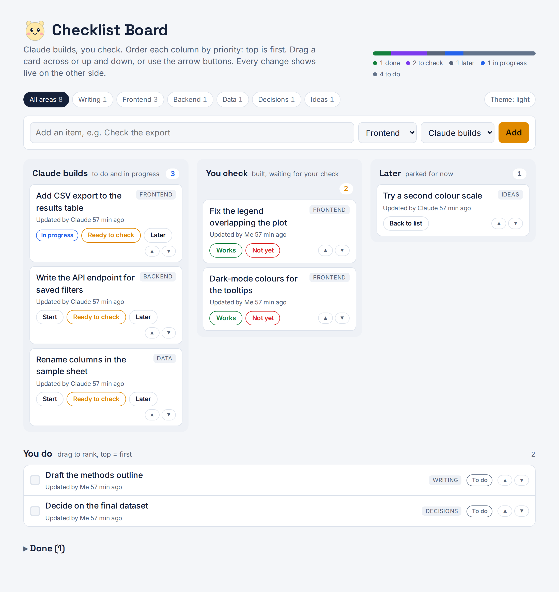
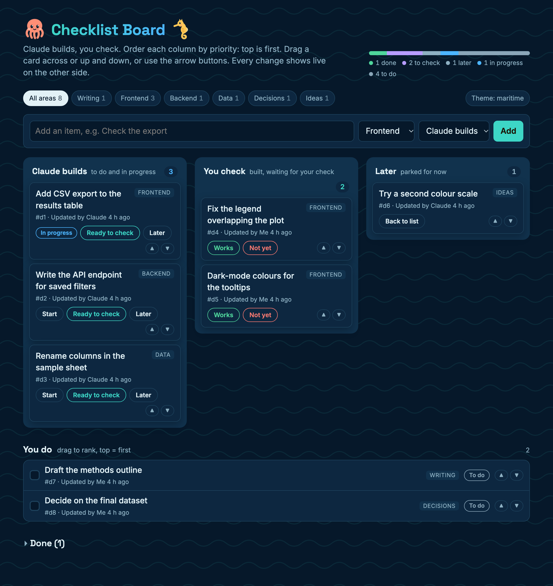
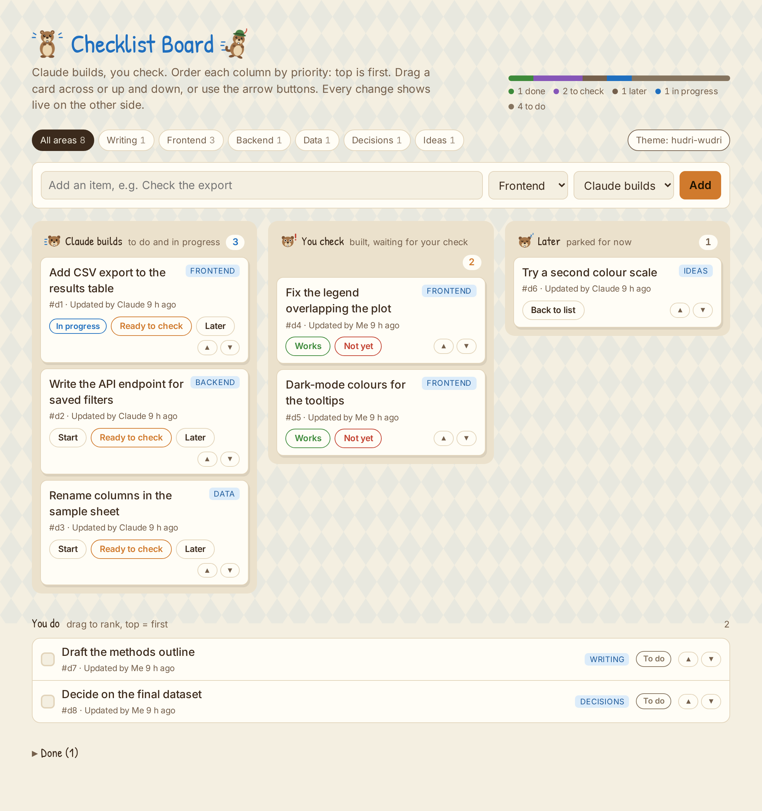

# Checklist board for working with Claude

| Light | Dark | Cute | Maritime | Hudri-wudri |
| --- | --- | --- | --- | --- |
|  |  |  |  |  |

A small shared to-do board for a human and Claude. Claude builds, you check.
It is a single HTML page that runs as a **claude.ai Artifact** with the `db` and `comments` capabilities.


## Set up

1. Clone the repo or download index.html:
   ```bash
   git clone https://github.com/strasserle/checklist-board.git && cd checklist-board
   ```
2. In Claude (claude.ai or Claude Code), ask: *"Publish `index.html` from this repo as an
   artifact with the `db` and `comments` capabilities."* The page reads and writes the
   collection `tasks`; `comments` powers the "Send to Claude" box (without it that box is hidden).
3. Open the artifact link. The board starts empty; add the first item in the form at the top.
4. Optional: add the snippet below to your `CLAUDE.md` so Claude keeps the board in sync.

## How it works

One document per row in the collection `tasks`:

| field | meaning |
| --- | --- |
| `title` | what to do |
| `status` | `todo`, `doing`, `test`, `later`, `done` |
| `who` | whose move it is: `Claude`, `Me` |
| `area` | one of the areas defined at the top of the script (edit `AREAS`) |
| `detail` | Claude's answers and results |
| `note` | your own notes on the row |
| `thread` | the message history with Claude: a map of `{from, at, text}` entries keyed by timestamp |
| `chat` | optional id of the Claude chat that owns the row, so messages go to the right session |
| `rank` | order within a column (top = first) |
| `createdAt`, `updatedAt`, `updatedBy` | set by the page |

Workflow: Claude takes a `todo` row, sets it `doing`, and when finished sets `test` with
`who` = `Me` and writes in `detail` what was done and how it was checked. You press **Works**
(`done`) or **Not yet** (back to Claude; say what is wrong in the row's message box). Only you move a row to `done`.

To talk to Claude about one row, open the card and use **Send to Claude**. The message goes to a
running Claude session that is watching the artifact, and the history stays on the row.

## Snippet for your CLAUDE.md

```markdown
## Checklist board
My to-do list is a claude.ai artifact: <your artifact URL> (db collection `tasks`,
read and write it with the `ArtifactData` tool).
- Messages I send from a row's "Send to Claude" box reach you as a comment starting with
  `[board row <id>: <title>]`. Answer in the comment thread and also append the answer to the
  row's `thread` map as `{from: "Claude", at: <ISO time>, text}` under a new timestamp key.
- Put results in `detail`; my `note` is only my own notes.
- Create a row for every new task I name before starting it (status `doing`, `who` "Claude").
- When finished, set status `test` and `who` "Me"; say in `detail` what was done and how it
  was verified. Only I move a row to `done`.
- Writes need `if_version`; use `batch` for several rows. Never delete rows.
```

## Customise

- `AREAS` near the top of the script: your own categories.
- `ME`: the name shown as the author of your edits.
- Five themes (light, dark, cute, maritime, hudri-wudri) via the Theme button.
- Screenshots: `python docs/make_screenshots.py` (needs Playwright with Chromium).

## License

MIT, see [LICENSE](LICENSE).

## Contribute

Pull requests with custom themes or new features are welcome ;)
