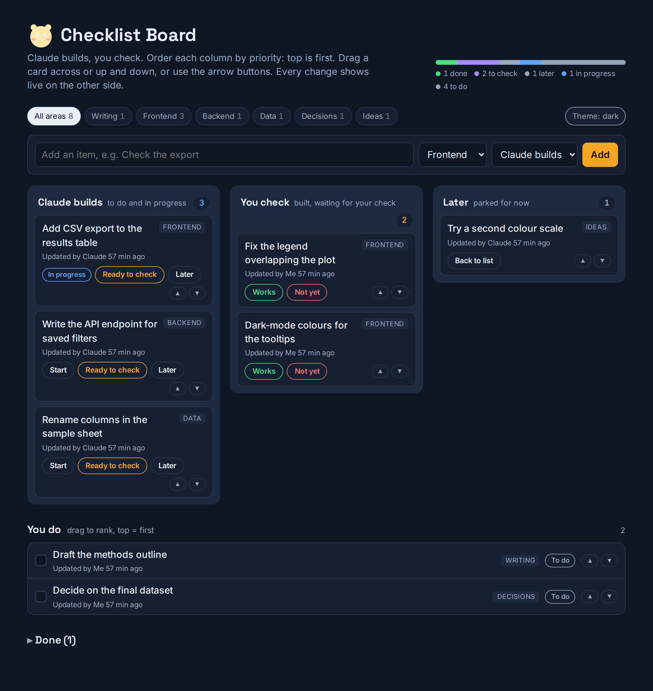
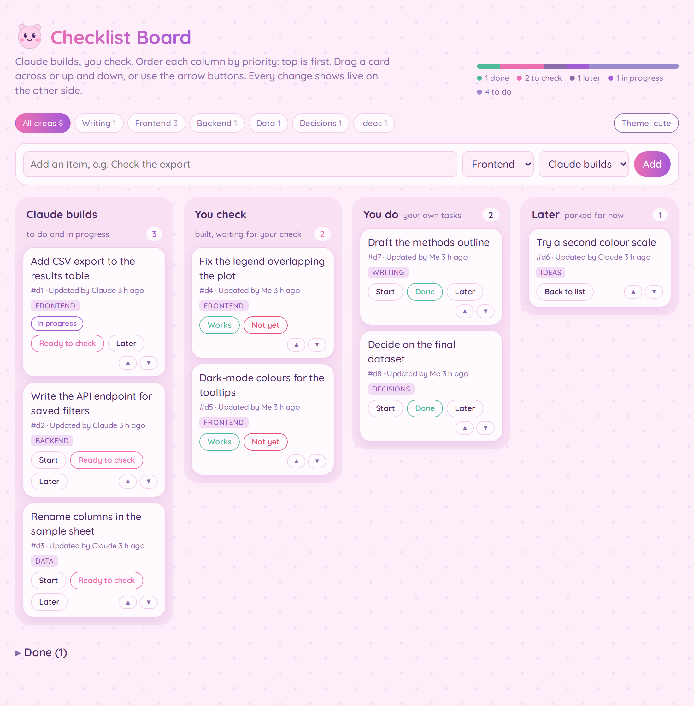

# Checklist board for working with Claude

| Light | Dark | Cute |
| --- | --- | --- |
|  |  |  |

A small shared to-do board for a human and Claude. Claude builds, you check.
It is a single HTML page that runs as a **claude.ai Artifact** with the `db` capability.


## Set up

1. Clone the repo or download index.html:
   ```bash
   git clone https://github.com/strasserle/checklist-board.git && cd checklist-board
   ```
2. In Claude (claude.ai or Claude Code), ask: *"Publish `index.html` from this repo as an
   artifact with the `db` capability."* The page reads and writes the collection `tasks`.
3. Open the artifact link. The board starts empty; add the first item in the form at the top.
4. Optional: add the snippet below to your `CLAUDE.md` so Claude keeps the board in sync.

## How it works

One document per row in the collection `tasks`:

| field | meaning |
| --- | --- |
| `title` | what to do |
| `status` | `todo`, `doing`, `test`, `later`, `done` |
| `who` | whose move it is: `Claude`, `Me` |
| `area` | one of the areas defined at the top of the script (edit `AREAS`) |
| `detail` | Claude's answers and results |
| `note` | your comments for Claude (an instruction or a question) |
| `rank` | order within a column (top = first) |
| `createdAt`, `updatedAt`, `updatedBy` | set by the page |

Workflow: Claude takes a `todo` row, sets it `doing`, and when finished sets `test` with
`who` = `Me` and writes in `detail` what was done and how it was checked. You press **Works**
(`done`) or **Not yet** (back to Claude, with a note). Only you move a row to `done`.

## Snippet for your CLAUDE.md

```markdown
## Checklist board
My to-do list is a claude.ai artifact: <your artifact URL> (db collection `tasks`,
read and write it with the `ArtifactData` tool).
- Read my `note` on a row as an instruction or question and answer it in `detail`.
- Create a row for every new task I name before starting it (status `doing`, `who` "Claude").
- When finished, set status `test` and `who` "Me"; say in `detail` what was done and how it
  was verified. Only I move a row to `done`.
- Writes need `if_version`; use `batch` for several rows. Never delete rows.
```

## Customise

- `AREAS` near the top of the script: your own categories.
- `ME`: the name shown as the author of your edits.
- Three themes (light, dark, cute) via the Theme button.
- Screenshots: `python docs/make_screenshots.py` (needs Playwright with Chromium).

## License

MIT, see [LICENSE](LICENSE).
